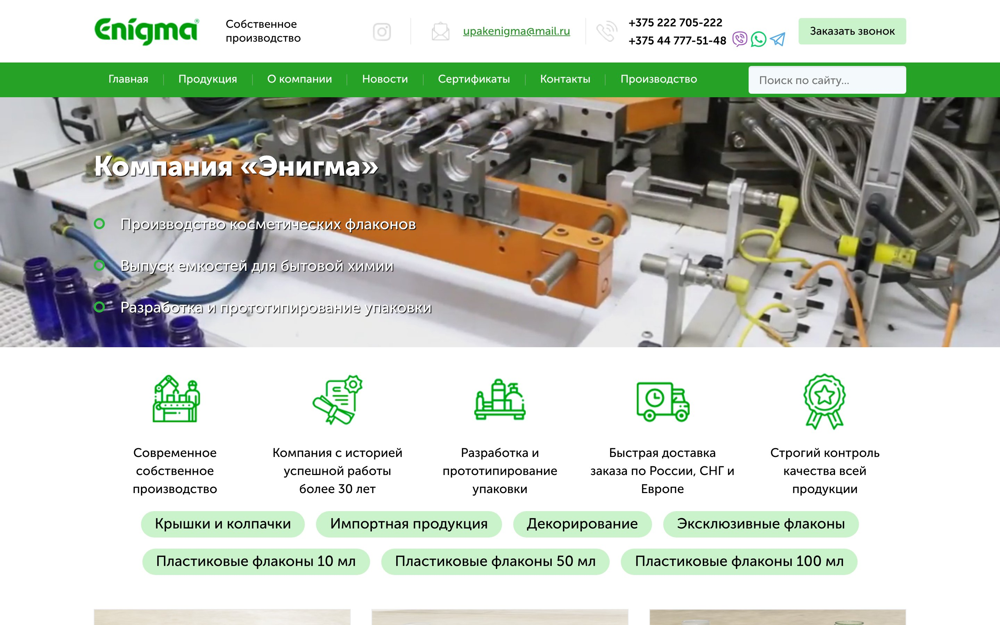

# Enigma: design extraction of upakenigma.ru

**What it is.** [upakenigma.ru](https://upakenigma.ru) (now [upakenigma.com](https://upakenigma.com)) is the website of **ODO «ENIGMA»**, a plastic-packaging manufacturer in Mogilev, Belarus, founded in 1992 and producing its own packaging since 2000. It makes PET, PET-G, PE, PVC and PP bottles, caps and closures for cosmetics, household chemicals and medical products. It also prints on and decorates them (silk-screen, heat-transfer, hot-foil). The site is a B2B lead-generation catalog of about 46 products: no prices and no cart; every product leads to a "leave a request" form. More in [docs/company.md](docs/company.md).

This repository holds the site's design, extracted from the live pages on 11 November 2026.



## Contents

| Path | What it is |
|---|---|
| [`docs/design-system.md`](docs/design-system.md) | The full design spec: brand, color, typography, layout, components, imagery, motion, responsive behavior, asset inventory |
| [`docs/company.md`](docs/company.md) | The business: history, products, product data model, sales model, site map, tech stack |
| [`docs/audit.md`](docs/audit.md) | Bugs and weaknesses found while measuring, with evidence and fixes |
| [`tokens/tokens.json`](tokens/tokens.json) | Design tokens (source of truth) |
| [`tokens/tokens.css`](tokens/tokens.css) | The same tokens as CSS custom properties (`--enigma-*`), generated |
| [`styleguide/index.html`](styleguide/index.html) | Visual reference: every component rebuilt from the tokens alone |
| [`screenshots/`](screenshots) | Full-page captures of the home, category, product, about and contacts pages, mobile home, and two bug captures |
| [`scripts/fetch-assets.sh`](scripts/fetch-assets.sh) | Downloads the original logo, icons and backgrounds into the git-ignored `reference/` |
| [`scripts/build_tokens.py`](scripts/build_tokens.py) | Regenerates `tokens.css` from `tokens.json` |

## The design in one paragraph

The design is a white page with one saturated green (`#26A226` for the menu bar, a `#00B300 → #0B8E1C` gradient on buttons) and a deep teal-black (`#0C3741`) for secondary text, plus mint and pale-blue tints. All type is **Museo Sans Cyrl**: weight 900 for centered headlines, 500 (declared as 400) for body text. Everything sits in a **fixed 1170 px** container with a 3-column product grid of 370 px cards. The header pairs a 90 px white contact bar with a 50 px green menu bar, and the hero is a looping factory video. Pill-shaped mint category chips, light molecule-pattern backgrounds, hexagon process steps, and a name-and-phone request form at the end of every page complete the look.

## Using it

Open `styleguide/index.html` in a browser. To see the real logo and icons instead of placeholders, download them first:

```bash
scripts/fetch-assets.sh
```

After editing `tokens/tokens.json`, regenerate the CSS:

```bash
python3 scripts/build_tokens.py
```

## Top findings

1. At **1366–1536 px**, the most common laptop widths, the benefits card hides the catalog title and the three core category links.
2. On **tablets in portrait** (768–1000 px) the fixed-width layout is clipped on the right.
3. Both **ISO 9001 certificates shown on the site have expired** (2020 and 2025).
4. Most brand greens **fail WCAG AA** as text or under white text.
5. On **phones** the menu is always expanded and pushes the catalog about two screens down.

Details and the rest are in [docs/audit.md](docs/audit.md).

## How this was extracted

The pages were rendered in headless Chromium (Playwright) at widths from 390 to 1920 px. Computed styles were read for every component and totaled across the page (colors by text length and area, font sizes, radii, shadows). The site's six stylesheets were parsed for fonts, breakpoints and hover states, and colors were sampled from the logo and icon images. Analytics and third-party widgets were blocked during capture.

## Rights

The logo, photos, icons and video belong to ODO «ENIGMA», and the site's fonts (Museo Sans Cyrl, Geometria) are commercial. None of them are committed here; `scripts/fetch-assets.sh` downloads the assets for local study only and does not download fonts. The screenshots are included for reference and analysis.
