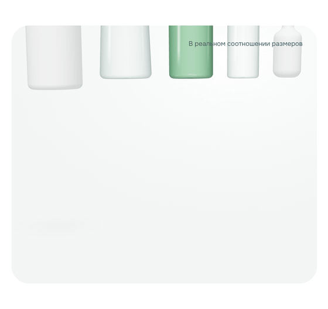
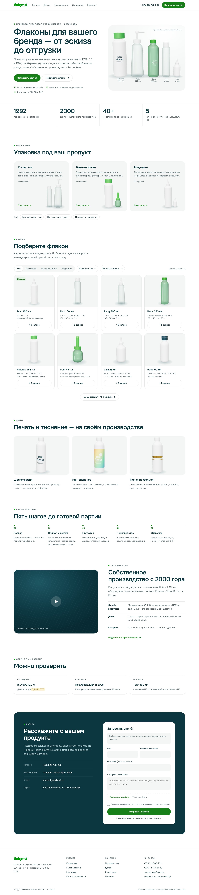

# Landing page concept

A sketch of a modern, minimal homepage for Enigma, built from what the [design extraction](../docs/design-system.md) and the [audit](../docs/audit.md) found. It is a working HTML page, not a static picture: open [`index.html`](index.html) in a browser. Run `scripts/fetch-assets.sh` first to see the real logo; otherwise a text wordmark stands in.

**This is a redesign concept, not the company's site.** The form does not send anything, and the page says so in its footer.

A sharper recording of the whole hero is in [`screenshots/concept-3d-hero.mp4`](../screenshots/concept-3d-hero.mp4).

| Desktop (1440 px) | Phone (390 px) |
|---|---|
|  |  |

## Principles

1. **Product first.** The hero shows the bottles, not the machinery. The factory video moves to the Production section.
2. **One action.** "Запросить расчёт" (request a quote) is the only primary button. It appears in the header, the hero and, on phones, a floating bar, and every route ends in one form.
3. **Data on the surface.** Every card shows volume, neck size, material, dimensions and weight, and the catalog has real filters.
4. **Quiet visuals.** Generous white space, one accessible green, the site's existing teal ink, and one typeface. Hairlines instead of shadows; shadows appear only on hover.
5. **Fluid and mobile-first.** No fixed widths, so nothing gets clipped or covered at any screen size.

## Page, top to bottom

| # | Section | What it does | Fixes |
|---|---|---|---|
| 1 | Sticky header, 72 px | Logo, 5 links, phone, CTA. The CTA turns into a request counter ("Запрос 2") | Replaces the 140 px two-bar header |
| 2 | Hero | Headline "Флаконы для вашего бренда — от эскиза до отгрузки", a lead, two buttons, three proof points. On the right, five real models in animated 3D **at true relative size**, built from their spec tables | Hero message no longer hidden on phones ([audit #5](../docs/audit.md#5-mobile-menu-first-content-later)) |
| 3 | Facts | 1992 founded · 2000 own production · 40+ models · 5 materials | |
| 4 | Segments | Three large cards (Cosmetics 13 models, Household chemicals 16, Medical 9) plus links to caps, custom shapes and imports | Core categories can't be covered any more ([audit #1](../docs/audit.md#1-category-links-hidden-on-common-laptop-screens)) |
| 5 | Catalog preview | Use / volume / material filters with a live count and an empty state. Cards with full specs and "+ В запрос" | Filters the site promises but lacks ([audit #6](../docs/audit.md#6-the-promised-filters-dont-exist)) |
| 6 | Decoration | Silk-screen, heat transfer, hot foil, each on the same bottle | |
| 7 | Process | Five steps: request → selection and quote → prototype → production → shipping | |
| 8 | Production | Video slot and the equipment story (Jomar injection blow molding, in-house decoration) | |
| 9 | Documents | Certificate **with its validity date**, trade shows, new product (Tear 360 ml) | Expired certificates ([audit #3](../docs/audit.md#3-expired-certificates-are-on-display)) |
| 10 | Contact | One form: name, phone or e-mail, company, brief, file upload, consent. The models picked in the catalog appear in it as removable chips | Replaces the current homepage's 10 near-identical modal forms |
| 11 | Footer | Catalog, company and contact links, legal line, concept disclaimer | |

## Visual system

| | Value | Note |
|---|---|---|
| Ink | `#0C3741` | Kept from the current site; 12.8:1 on white |
| Secondary text | `#4A6166` | 6.6:1 on white |
| Accent | `#188018`, hover `#127512` | The accessible green from `tokens/tokens.css`; 5.1:1 either way |
| Brand mark | `#00A10A` | Small dots and the logo only, never text |
| Surfaces | `#FFFFFF`, `#F3F6F4`, mint `#E6F3E7`, line `#E3E9E7` | |
| Type | [Onest](https://fonts.google.com/specimen/Onest), free with Cyrillic | Headings 600 with tight tracking (62 / 44 / 20 px); body 16 / 1.6; 13 px uppercase labels |
| Shape | Pill buttons and filters; 18–32 px radii on cards and panels | |
| Imagery | Animated 3D bottles built from each model's real height, diameter and neck size ([details below](#3d-bottles)) | For production, use the factory's CAD models, or consistent studio photos with the same backdrop, light and white / clear / tinted trio |

Every text color pairing meets WCAG AA.

## 3D bottles

Every bottle on the page is real-time 3D ([Three.js](https://threejs.org) r160, loaded from jsDelivr).

- **Geometry.** Each body is a lathe of the model's real profile in millimetres: height, diameter, neck size, plus a shoulder and base shape per family. The caps are modeled too: the pump with its spout, the flip-top with its hinge line and thumb tab, ribbed screw and measuring caps, and the dropper and wick caps. Models in one scene keep their true relative size.
- **Materials.**
  - White PE is a satin plastic.
  - Clear and green-tinted PET use a small Fresnel tweak to the shader: nearly transparent facing the camera, denser and tinted at the rims, the way clear plastic reads on a light backdrop. Highlight streaks are fixed to the "studio lights", so they stay put while the bottle turns.
  - Prints ("ваш бренд") are canvas textures wrapped around the body; the foil band is real metal shading.
- **Motion.**
  - The hero bottles drop in one after another, then turn slowly and float, and the camera follows the pointer slightly.
  - Catalog, segment and decoration bottles turn slowly and spin up and lift on hover.
  - With `prefers-reduced-motion`, everything renders once, still.
- **Performance.**
  - One WebGL renderer draws every scene and copies it into a canvas inside its card. That keeps the page to a single GPU context (browsers cap them at about 16) and keeps normal page layering.
  - Only bottles near the viewport animate.
  - Pixel ratio is capped at 2 (1.5 on phones).
- **Fallback.** If WebGL or the CDN isn't available, the page keeps the flat SVG drawings. The hero waits up to 2.5 s for 3D before showing them, so there's no flash.

For production, convert the factory's real CAD files (STEP/IGES to glTF) instead of the lathe approximations, and self-host Three.js.

## What works in the sketch

- 3D bottles throughout, as above.
- Filtering by use, volume and material, with a live count and an empty state.
- "+ В запрос" on a card updates the header counter and adds a chip to the form; removing the chip updates the card.
- Clicking a segment card filters the catalog to that segment.
- On phones: a menu sheet, and a floating "Позвонить / Запросить расчёт" bar that appears once the hero's own buttons scroll away.
- No horizontal overflow from 390 to 1920 px.

## Placeholders and things to confirm with the company

- **Certificate validity date:** a highlighted `ДД.ММ.ГГГГ` placeholder.
- **Media:** the production video and product photography.
- **Tear 360 ml:** its dimensions aren't published, so its 3D model is approximate.
- **Catalog preview:** shows 8 of the 46 models.
- **Copy built from the site's claims:** "Прототип под ваш дизайн", "Печать и тиснение в одном цикле", "без подрядчиков" for decoration, and Fum bottles being for fumigator liquids. These should be confirmed.
- **Language:** whether an English version is wanted, given the Europe market claim.
