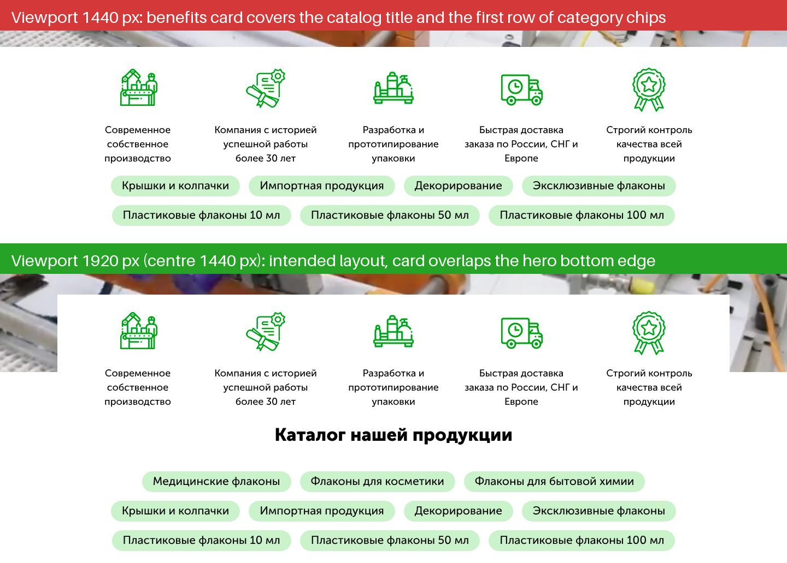
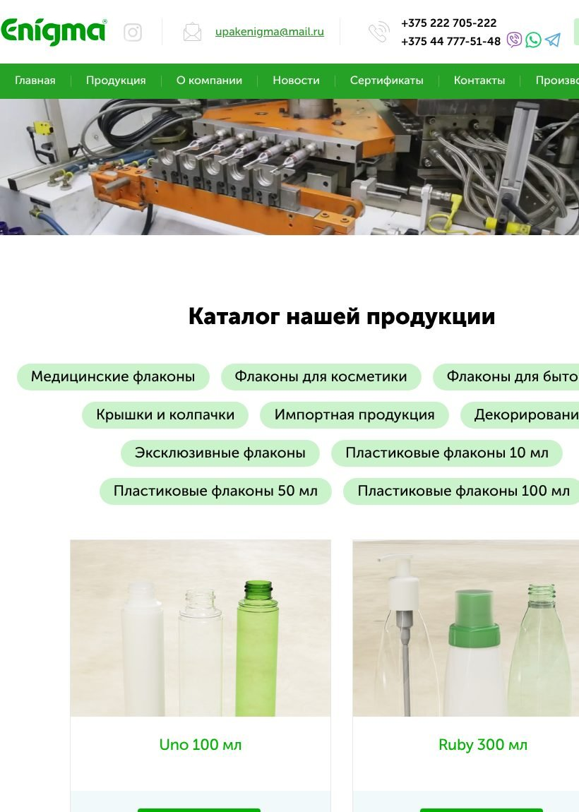

# upakenigma.com: issues found during the design extraction

These problems surfaced while measuring the live site on 11 November 2026, using headless Chromium at several viewport widths. They are ordered by how much they hurt a visitor or the business. Each one was reproduced, not inferred from the code.

| # | Issue | Impact |
|---|---|---|
| 1 | Benefits card hides the three main category links at 1366–1536 px | High |
| 2 | Tablets in portrait (768–1000 px) get a clipped page | High |
| 3 | Displayed ISO 9001 certificates have expired | High (trust) |
| 4 | Brand greens fail WCAG contrast for text and buttons | Medium |
| 5 | Mobile: menu fills the first screen; key blocks hidden | Medium |
| 6 | SEO copy promises product filters that don't exist | Medium |
| 7 | Outdated, heavy stack (PHP 5.3, jQuery 1.7, ~520 KB CSS, 3 MB video) | Medium |
| 8 | Broken social preview; no server-side HTTPS redirect; weak heading structure | Low–medium |
| 9 | Font setup errors | Low |
| 10 | Smaller accessibility and consistency issues | Low |

## 1. Category links hidden on common laptop screens

The benefits card ("Современное собственное производство"…) is meant to overlap the bottom edge of the hero video. At **1366, 1440 and 1536 px**, three of the most common laptop widths, it covers both the "Каталог нашей продукции" title and the **first row of category chips: Medical, Cosmetic and Household-chemical bottles**. Those are the site's three core categories. At 1600 and 1680 px only the title is covered. At 1280 px and below, and at 1920 px, the layout is correct.

**Cause:** the space under the hero is reserved by width-specific rules in `design/default/style.css`. In the `@media (min-width: 1301px) and (max-width: 1655px)` block, the rule `#catalog { padding: 200px 0 !important }` is **commented out**, so nothing reserves space at those widths. The 1658–1890 px block has an active `#catalog { margin: 225px auto !important }`, which is still slightly short at 1680. **Fix:** keep the card in normal flow, or derive the catalog's top spacing from the card's height instead of per-width values.

## 2. Tablets in portrait get a clipped page

From 768 px up to about 1000 px the container is a fixed 968 or 1000 px, wider than the screen. Overflow is hidden, so the right edge of the page is cut off with no way to scroll to it. On an 820 px iPad Air you lose:

- the "Заказать звонок" button
- the last menu item
- parts of the chips
- the second product column
- the ecology banner

The logo also touches the left edge.

**Fix:** a fluid container, for example `max-width: 1170px; padding: 0 16px`, instead of stepped fixed widths.

## 3. Expired certificates are on display

"Наши сертификаты и декларации" (our certificates and declarations) shows two ISO 9001:2015 (GOST R ISO 9001-2015) certificates:

| Issuer | Registered | Valid until | Status today |
|---|---|---|---|
| TQC (Transparent Quality Certification) | 25.08.2022 | **25.08.2025** | Expired ~15 months ago |
| BQC (Bureau Quality Certification) | 01.09.2017 | **01.09.2020** | Expired 6 years ago |

The other scans in the section are trade-show participation diplomas from 2015–2017, not certificates or declarations. B2B buyers, especially in medical and cosmetics, do check these. **Fix:** publish current certificates with their validity dates, and show the diplomas separately, if at all.

## 4. Several brand greens fail WCAG contrast

| Where | Colors | Ratio | AA (normal text 4.5 / large 3) |
|---|---|---|---|
| Menu text (16 px) | white on `#26A226` | 3.34 | Fails for 16 px text |
| Product names (22 px, weight 500) | `#00B300` on white | 2.82 | Fails |
| Primary buttons (16 px bold) | white on `#00B300 → #0B8E1C` | 2.82 → 4.29 | Fails (the text shadow helps legibility but doesn't count) |
| Links, news titles (16–20 px) | `#309330` on white | 3.93 | Fails for normal text |
| Footer credit (14 px) | `#B2B2B2` on white | 2.12 | Fails |

The menu hover also flips its text to **black** on `#199619`, which looks like a bug even though it passes (5.42).

**Fix:** keep the bright greens for large fills and illustration, and use `--enigma-color-a11y-green` (`#188018`, 5.07:1) and `-hover` (`#127512`, 5.87:1) for text, links and button fills. Both are in `tokens/tokens.css`.

## 5. Mobile: menu first, content later

At phone width (390 px):

- **The menu is always expanded**, with no hamburger: 7 full-width green rows, about 340 px tall, under the contact block. The first product is roughly two screens down.
- **The hero message is hidden.** The hero text ("Компания «Энигма»" and its bullets) and the benefits card are hidden below about 980 px, so mobile visitors see only a strip of machine video.
- **The process steps are hidden** below 500 px.
- **Search is unavailable** on every screen narrower than 1200 px.

See [`screenshots/home-390-mobile@2x.jpg`](../screenshots/home-390-mobile@2x.jpg).

## 6. The promised filters don't exist

The homepage SEO text says "Удобная система фильтрации помогает быстро выбрать нужный объём, форму, тип укупорки" (a convenient filter system helps you quickly choose volume, shape and closure type). There are no filters on `/products` or on any category page, only the category chips. `/products` is a single grid of 46 cards, and cards show only a name, so buyers have to open each product to see its volume, neck size or material.

**Fix:** the data already exists in every product's spec table (neck diameter, volume, weight, height, diameter, material). Expose it as filters and show the key values on the cards.

## 7. Outdated and heavy stack

- **PHP 5.3.29** (from the `X-Powered-By` header) has been end-of-life since August 2014 and gets no security fixes.
- **jQuery 1.7.1** dates from 2011.
- **About 520 KB of CSS in 8 stylesheets.** That includes WordPress block-library and Dashicons CSS (77 KB) on a site that isn't WordPress. The 245 KB `style-global.css` still holds rules for old event and seasonal pop-ups (New Year, Intercharm, AgroFarm, Gold Autumn) that no longer appear anywhere on the site.
- **Hero video:** 3.1 MB, autoplaying, with no poster image. It is only 1346 × 576, so it is upscaled on wide screens.
- **Product images** are single 470 × 470 files with no `srcset`.

## 8. SEO and sharing

- **Broken social preview:** `og:image` points to `design/default/images/logo.png`, which returns **404**. `og:type` is "article" on the homepage, and `og:site_name` repeats the whole meta description.
- **No server-side HTTPS redirect:** `http://upakenigma.com/` answers 200. Only an inline script sends visitors to HTTPS, so crawlers and no-JS clients see an HTTP copy. (The `.ru` domain does 301 correctly.)
- **Heading structure:** the homepage's only H1 ("Пластиковые флаконы от производителя") sits mid-page below the products. The hero title and every section title are H3, and there are no H2s.
- **Outdated tag:** there is still a `meta keywords` tag, which search engines ignore.

## 9. Font setup

- Two `@font-face` rules both claim weight 400 (the Museo 300 and 500 files). The later one wins, so the 300 file is downloaded and never used, and "regular" text is really Museo 500.
- No face is declared for 500, so `font-weight: 500` (product names) falls back.
- Geometria (2 weights) is declared but unused.
- The faces ship legacy EOT and SVG formats and no `font-display`, so text is invisible until the fonts load.

## 10. Smaller things

- **Accessibility:**
  - Viber, WhatsApp, Telegram and Instagram links are bare images with no `alt` or label, so screen readers announce nothing.
  - Forms use placeholders instead of labels.
  - Certificate images have `alt="#"` or no `alt`.
  - The ecology "Узнать подробнее" is a `<button>` that navigates by script.
- **Inconsistent contacts:**
  - Phone formats differ: `+375 222 705-222` in the header, `8 0222 705-222` in the footer.
  - The `tel:` links contain spaces.
  - Telegram links differ: `telegram.me/gc_enigma` in the header, a phone-number link in the footer.
- **Repetition:** "Разработка и прототипирование упаковки" (packaging design and prototyping) appears twice on the first screen, as a hero bullet and as a benefit.
- **News thumbnails** are round crops of photos with different aspect ratios, so some render as ovals and the rows don't line up.
- **Template leftovers:** the source contains commented-out "reviews" and "clients" blocks. The client logos (LG, a sports bar, a beauty salon, medical centers…) don't look like Enigma's customers.
- **Analytics:** two Yandex.Metrica counters run on every page. Check that they aren't double-counting.
