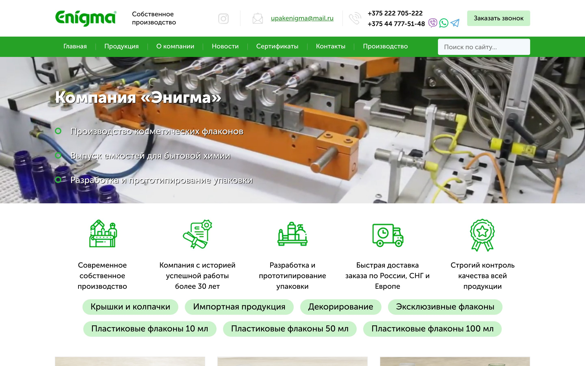

# Enigma website: extracted design system

This is the design of **upakenigma.com** (upakenigma.ru redirects there) as it was live on 11 November 2026. Values come from computed styles measured in headless Chromium, mostly at a 1440 px viewport, cross-checked against the site's CSS and screenshots.

- Machine-readable tokens: [`tokens/tokens.json`](../tokens/tokens.json), compiled to [`tokens/tokens.css`](../tokens/tokens.css)
- Visual reference that rebuilds each component from the tokens: [`styleguide/index.html`](../styleguide/index.html)
- Screenshots: [`screenshots/`](../screenshots)
- Problems found along the way: [`audit.md`](audit.md)

## 1. At a glance

The site uses a common template for Russian-language B2B manufacturer sites:

- **A white page with one saturated "eco" green.** Green is the only brand color. A deep teal-black carries secondary text, and pale mint and blue-white tints fill bands and controls.
- **Heavy black headlines.** Museo Sans Cyrl at weight 900, centered.
- **A factory video in the hero** and science-flavored backgrounds: light-grey molecule and hexagon line patterns.
- **Glossy uppercase gradient buttons** with a text shadow and an inset bottom edge.
- **Lead-capture forms everywhere.** The page is built to collect a name and a phone number, not to sell online.
- **A fixed 1170 px desktop layout.** It is not fluid; smaller screens get stepped fixed widths.

## 2. Brand

| Element | Details |
|---|---|
| Logo | Green wordmark "Enígma" with an acute accent on the í and a ® mark. One color, about `#009C08`. Supplied only as a 155 × 48 PNG (no SVG). Same size in header and footer. It is also molded on real bottles, visible in the consultation photo |
| Secondary mark | Circular "SINCE 1992" mark with a leaf-shaped "e", used on the ecology banner (raster) |
| Header tagline | "Собственное производство" (own production) |
| Voice | Formal B2B Russian with the polite capitalized "Вы / Ваш". Leads with proof points: 30+ years, own production, quality control, fast delivery across Russia, the CIS and Europe, custom design and prototyping. SEO keyword phrases ("ПЭТ флаконы оптом от производителя") appear in titles and long text blocks |
| Calls to action | "Оставить заявку" (leave a request), "Заказать звонок" (request a call), "Узнать подробнее" (learn more), "Отправить заявку" (send request) |

## 3. Color

### Palette

| Token | Hex | Role | White text on it |
|---|---|---|---|
| `green.logo` | `#009C08` | Logo | 3.65 |
| `green.bright` | `#00B300` | Button gradient top and hover; product-card titles | 2.82 ✗ |
| `green.base` | `#26A226` | Menu bar, active chip, card quick-view bar | 3.34 (large text only) |
| `green.deep` | `#199619` | Menu item hover, quick-view hover | 3.88 (large text only) |
| `green.dark` | `#0B8E1C` | Button gradient bottom | 4.29 (large text only) |
| `green.link` | `#309330` | Underlined links, breadcrumbs, news titles | 3.93 (large text only) |
| `green.icon` | `#00A000` | Line-icon strokes (raster) | — |
| `green.ring` | `#2DB63E` | Ring bullets in the hero list | — |
| `green.divider` | `#62AF62` | 1 × 16 px menu separators | — |
| `green.mint` | `#CBF3CB` | Idle chips, call-request button (black text, 17.2) | — |
| `teal` | `#00C4A4` | Hexagon outlines and arrows in "Как мы работаем" | — |
| `ink.black` | `#000000` | Headings and default body text | — |
| `ink.teal` | `#0C3741` | Secondary text: cards, news, steps, spec table (12.8 on white) | — |
| `ink.footer` | `#393E42` | Footer list text | — |
| `ink.muted` | `#B2B2B2` | Developer credit (2.12 on white ✗) | — |
| `surface.tint` | `#F2F9FA` | Card footer band, page-title band, certificate frames | — |
| `surface.input` | `#F4F9FB` | Inputs and search | — |
| `surface.row` | `#F5F8F9` | Spec-table cells | — |
| `border.card` | `#E8E8E8` | Product-card border | — |
| `border.newsRule` | `#94B2C4` | 28 × 2 px rule under news titles | — |
| `border.dot` | `#D5DADC` | Carousel dots | — |
| `feedback.errorRing` | `#FA94A1` | 3 px ring around an invalid input | — |

"White text on it" is the WCAG contrast ratio. AA requires 4.5 for normal text and 3 for large text (24 px, or 18.7 px bold). Most brand greens are too light for white body-size text or for green text on white. The tokens therefore add two **suggested** greens that are not on the live site: `a11y.green` `#188018` (5.07) and `a11y.greenHover` `#127512` (5.87). See the [audit](audit.md#4-several-brand-greens-fail-wcag-contrast).

### How much of each

By amount of text: black 62 %, teal ink 15 %, white (on green and video) 11 %, link green 8 %, bright green 2 %. By area, white dominates. Green comes in small, saturated doses: the menu bar, buttons, chips and links.

### Gradients and image backgrounds

- **Primary button:** `linear-gradient(180deg, #00B300, #0B8E1C)`.
- **Ecology banner:** raster gradient from deep blue (about `#0B5EA8`) to pale cyan (about `#A6E4F2`), 1170 × 260, with the "SINCE 1992" mark. It is the only use of blue.
- **Page-title band and certificates:** `bg-certificates.jpg`, light-grey molecule line art on `#F2F9FA`.
- **"Как мы работаем" (how we work):** tiled `bg-steps.jpg`, faint chemical-structure line art.
- **Consultation block:** `bg-consult.jpg`, a photo of green and blue bottles carrying the Enigma logo on a grey background.

## 4. Typography

### Family

One family: **Museo Sans Cyrl** (exljbris), self-hosted as `MuseoSansCyrl`. It is a commercial font. **Geometria** is declared too but is never used on the page.

How the site maps CSS weights to font files. The mapping is buggy, and the rendered look depends on it:

| CSS weight | File that renders | Note |
|---|---|---|
| 300 | MuseoSansCyrl-**100** | Very thin; used for the lead line |
| 400 | MuseoSansCyrl-**500** | The 300 file and the 500 file are both declared as weight 400, and the later one wins. **Body text is really Museo Sans 500** |
| 500 | (falls back to 400, so the 500 file) | No 500 face is declared |
| 700 | MuseoSansCyrl-700 | Bold |
| 900 | MuseoSansCyrl-900 | All headings |

To match the look, use Museo Sans Cyrl 500 for body text, 700 for buttons and phone numbers, and 900 for headings. If you can't license it, Golos Text and Onest are free Cyrillic families with a similar build; the style guide falls back to Golos Text.

### Scale

All sizes are fixed pixels at desktop.

| Token | Size / line height | Weight | Color | Used for |
|---|---|---|---|---|
| `display` | 40 / 48 | 900 | black, or white with a 1 px black shadow on video | Hero title, H1 of inner pages |
| `sectionTitle` | 33 / 43 | 900 | black | Centered section titles ("Каталог нашей продукции", "Как мы работаем"…) |
| `bannerTitle` | 30 / 36 | 700 | white | Ecology banner |
| `stepNumber` | 30 / 30 | 900 | white | Digit on the hexagon badge |
| `lead` | 24 / 30 | 300 | teal ink, with a 400-weight phrase | "Произведем Ваш заказ **в кратчайшие сроки**…" |
| `heroBullet` | 22 / 30 | 400 | white with shadow | Hero list |
| `cardTitle` | 22 / 26, −0.3 px tracking | 500 | bright green | Product names |
| `formTitle` | 22 / 30 | 400 | black | Form-card title; "Характеристики" uses 22 / 28 |
| `chip` | 21 / 18 | 400 | black, or white when active | Category chips |
| `newsTitle` | 20 / 26 | 400 | link green | News titles |
| `stepCaption` | 20 / 30 | 400 | teal ink | Process-step captions |
| `benefit` | 18 / 26 | 400 | black | Benefit captions |
| `body` | 16 / 1.2 | 400 | black | Body text, menu, inputs, SEO copy |
| `bodyRelaxed` | 16 / 26 | 400 | teal ink | News excerpts |
| `button` | 16 / 16, uppercase | 700 | white with shadow | Primary buttons |
| `small` | 14 / 18 | 400 | muted grey | Developer credit |
| `legal` | 12 | 400 | black | Registration number in the footer |

Conventions: section titles are centered, and so is the long SEO text, which makes it hard to read. Uppercase appears only on buttons. Phone numbers are bold.

## 5. Layout

### Grid

- **Container:** `.w-center`, a fixed **1170 px**, centered (135 px margins at 1440). There is no fluid grid; see [responsive](#9-responsive-behavior).
- **Products:** 3 columns × 370 px with 30 px gutters (3 × 370 + 2 × 30 = 1170). Product pages show recommendations 4 across in a carousel.
- **Benefits:** 5 × 210 px items inside a 1230 px white card.
- **Certificates:** 4 per row, 280 × 396 tiles.
- **News:** 2 per row, 570 px each.
- **Process steps:** 3 × 2 grid of 300 px items with 38 px side margins, in a snake order: 1 → 2 → 3, down, then 4 → 5 → 6 from right to left.

### Header

The header is 140 px tall and scrolls away with the page (not sticky). Apart from third-party widgets, the only fixed element on the page is the scroll-to-top button.

1. **Contact bar, 90 px, white.** From left: logo (155 × 48), tagline, Instagram icon, divider, mail icon and e-mail link, divider, phone icon with two bold numbers and Viber / WhatsApp / Telegram icons, then the mint "Заказать звонок" button on the right.
2. **Menu bar, 50 px, `#26A226`.** Seven links (Главная, Продукция, О компании, Новости, Сертификаты, Контакты, Производство), then a search field on the right.

### Homepage, top to bottom (1440 px)

| # | Block | Height | Notes |
|---|---|---|---|
| 1 | Header | 140 | |
| 2 | Video hero | 410 | Full-width looping factory video. "Компания «Энигма»" over three ring-bulleted lines, left-aligned in a 585 px column. No overlay; only a text shadow |
| 3 | Benefits card | 214 | White card meant to overlap the hero's bottom edge. **At 1366–1536 px it covers the catalog title and first row of chips** ([audit](audit.md#1-category-links-hidden-on-common-laptop-screens)) |
| 4 | Catalog | ~1300 | "Каталог нашей продукции", 10 category chips, 6 product cards |
| 5 | Ecology banner | 260 | "Мы заботимся об экологии" + button + text link |
| 6 | SEO text | ~360 | The page's only H1 ("Пластиковые флаконы от производителя") and 5 centered paragraphs |
| 7 | Certificates | ~1030 | "Наши сертификаты и декларации", 6 scans in a lightbox |
| 8 | How we work | ~940 | Six hexagon steps and the delivery lead line, on a pattern background |
| 9 | News | ~855 | "Новости компании", 6 items, "Перейти в новости" button |
| 10 | Consultation | 499 | "Остались вопросы?" and the form card over a photo |
| 11 | Footer | 213 | |

### Inner pages

Every inner page follows the same frame:

1. Header.
2. Title band (pattern on tint) with a 40 / 48 / 900 H1 and breadcrumbs ("Главная / …", green underlined links).
3. Page content.
4. The same consultation block.
5. Footer.

| Page | Content layout |
|---|---|
| Category | Chips with the active one filled green, a 3-column card grid, SEO copy below |
| Product | Large photo (about 670 px) on the left. On the right: "Наши преимущества" (4 small icon badges), the "Характеристики" table, and a request button. Below: the "Мы рекомендуем" carousel |
| About | Two columns: text on the left, building and trade-show photos on the right |
| Contacts | Google map on the left, contact list with icons on the right |

## 6. Components

### Buttons

| Variant | Size | Style |
|---|---|---|
| Primary, small | 174 × 45 | Card buttons. Green gradient `#00B300 → #0B8E1C`, radius 4, white 16 px bold uppercase, text-shadow `0 2px 2px rgba(0,0,0,.31)`, inset `0 -2px 0 rgba(167,83,0,.3)` |
| Primary, medium | auto × 60, 26 px side padding | Banner and "Перейти в новости" |
| Primary, large | 330 × 60 | Full-width form submit |
| Hover | — | Flat `#00B300`, `transition: all .3s` |
| Call request | 155 × 38 | Mint `#CBF3CB`, black 16 px text, radius 4 |

### Category chips

Pills 38 px tall with radius 20, a 9 × 20 px top/side padding, and 21 px text. Idle: mint background, black text. Hover and active: `#26A226` background, white text. They wrap onto centered rows.

### Inputs

- **Form inputs:** 330 × 60, `#F4F9FB`, radius 4, inset shadow `0 2px 2px rgba(0,0,0,.07)`, 25 px side padding, 16 px text. Placeholders: "Введите Ваше имя" (your name), "Введите Ваш телефон" (your phone). Invalid fields get an extra 3 px `#FA94A1` ring.
- **Search:** the same style at 227 × 40 with a loupe icon button.

### Product card

- 370 px wide, white, with a 1 px `#E8E8E8` border.
- **Image area:** 368 × 250, cropped from a 470 × 470 thumbnail. On hover, a 40 px `#26A226` bar reading "узнать подробнее" (learn more) slides up from the bottom; it darkens to `#199619` on its own hover.
- **Title:** 22 px weight 500 in `#00B300`, with 27 / 25 / 20 px padding.
- **Footer band:** 100 px, `#F2F9FA`, holding the small primary button. It opens the request modal "Заказать <product>".

### Specification table

462 px wide. Rows are 40 px, and each cell is `#F5F8F9` with a 1 px white line on top. Padding is 10 / 5 / 10 / 15 px. Labels are regular, values bold, and both use teal ink.

### Benefit item

A 144 × 126 green line icon (raster PNG) above an 18 / 26 caption, 210 px wide and centered.

### Process step

- **Shape:** a 198 × 169 flat-top hexagon outlined in teal, with a line icon inside.
- **Badge:** a filled green 53 × 45 hexagon on the left vertex, holding a white 30 px / 900 digit.
- **Caption:** below, 20 / 30 in teal ink.
- **Connectors:** teal arrows between steps.

Everything except the caption comes from one sprite, `icons-steps1.png`.

### News item

- **Photo:** 170 px wide with radius 50 %, absolutely positioned on the left. Photos of other shapes become ovals.
- **Title:** 20 / 26 in link green.
- **Rule:** 28 × 2 px in `#94B2C4`.
- **Excerpt:** 16 / 26 in teal ink.

### Certificate tile

A 260 × 376 scan inside a 10 px `#F2F9FA` frame (280 × 396 overall). It opens in a fancybox lightbox.

### Consultation block

- **Background:** full-width photo, 499 px tall.
- **Left:** "Остались вопросы?" (33 / 43 / 900), then two lines of 24 px text.
- **Right:** a 410 px white form card with 25 / 40 / 40 px padding and a 12 px "stacked sheets" image along its top edge. It holds the "Заявка на консультацию" title (22 / 30), two inputs and the large primary button.

### Ecology banner

1170 × 260 gradient image. The 30 / 36 / 700 white title sits above a medium primary button and a plain "Перейти на страницу" (go to page) link. The button is a `<button>` that navigates by script.

### Footer

White, with 40 / 45 px vertical padding. Four columns:

1. Logo, legal name, registration number and address.
2. Five category links: green and underlined, with 8 px grey ring bullets.
3. Phones in the domestic "8 0222…" format, messenger icons in their own brand colors, and the e-mail.
4. "Разработка сайта — студия Ultraweb.by" (site by Ultraweb.by), right-aligned in muted grey.

A vertical line separates columns 2 and 3.

### Other

- **Modals** (arcticmodal) for requests and callbacks share the form-card styling.
- **Scroll-to-top button:** fixed, 40 × 40 image, bottom right.
- **Carousel dots:** 20 px circles outlined in `#D5DADC`; the active dot is filled with it.

## 7. Imagery and icons

- **Product photos:** studio shots, usually three variants of one bottle side by side (opaque white, clear, translucent green), on a warm beige marble surface with soft light. Source thumbnails are 470 × 470 and are cropped to 368 × 250 on cards.
- **Hero video:** `vid.mp4`, 1346 × 576, 3.1 MB, autoplay / muted / loop, no poster image. It shows close-ups of the bottle-making machinery.
- **Icons:** raster PNG line icons with a single green stroke, in a stock "lineal" style:
  - Benefits: factory, certificate, bottles, delivery truck, award rosette.
  - Steps: request, ideas, calculation, bottle, production, shipping.
  - Header icons are grey line art.
  - Messenger icons are SVGs in each service's colors.
- **Patterns:** light-grey molecule and hexagon line drawings behind title bands, certificates and the process section. This is the main "chemistry and science" signal.
- **Documents:** certificate and diploma scans shown as-is.

## 8. Motion

- **Scroll reveals:** animate.css driven by `data-animate`. Cards and certificates use `fadeInUp` and steps use `fadeInRight`, with 1.0 s duration and 0.1 s delay.
- **Transitions:** `all 0.3s` for buttons, chips, menu and the quick-view bar; `all 0.25s ease-in-out` in a few places.
- **Hover reveal:** the card quick-view bar slides up.
- **Attention wiggle:** a `cycle` keyframe (2 s, infinite) shakes a callback badge injected by `bk.js`.

## 9. Responsive behavior

Measured by resizing the viewport. This is not taken from the CSS alone.

| Viewport | Container | What changes |
|---|---|---|
| ≥ 1200 | 1170 | Desktop as described |
| 768 – 1199 | 968 (1000 between about 900 and 1024) | 2 products per row, search hidden. Below about 980 px the hero text and benefits card are hidden. **Content is clipped on the right on tablets in portrait** ([audit](audit.md#2-tablets-in-portrait-get-a-clipped-page)) |
| 500 – 767 | 500 | Everything centered in one column. The menu is a stacked list, always open, with no hamburger. Process steps still shown |
| ≤ 499 | 330 | Process steps hidden too |

On phones the order is: logo, tagline, e-mail, phones and the call button (all centered), then 7 full-width green menu rows, the video strip, and the catalog. The first product appears after roughly two screens. See [`screenshots/home-390-mobile@2x.jpg`](../screenshots/home-390-mobile@2x.jpg).

The CSS also has width-specific fixes: 1301–1655 and 1658–1890 px for the hero video offset and catalog spacing, and 1010–1120 px for the step arrows. The overlap bug comes from these, because the catalog-spacing rule for 1301–1655 px is commented out. The tablet clipping comes from the fixed container widths.

## 10. Asset inventory

All paths are under `https://upakenigma.com/design/default/`. `scripts/fetch-assets.sh` downloads the non-font assets into the git-ignored `reference/assets/`.

| Asset | File(s) | Notes |
|---|---|---|
| Logo | `logo.png` | 155 × 48 PNG; no vector version on the site |
| Benefit icons | `icon-benefit-1.png` … `-5.png` | 144 × 126 |
| Process sprite | `icons-steps1.png` | 888 × 592 sprite: hexagons, badges, icons, arrows |
| Messenger icons | `viber.svg`, `whatsapp.svg`, `telegram.svg`, `instagram.svg` | 23 px |
| UI icons | `icon-loupe.png`, `icon-close.png`, `images/icon_top.png` | Search, modal close, scroll-to-top |
| Backgrounds | `bg-certificates.jpg`, `bg-steps.jpg`, `bg-consult.jpg`, `img-banner-charity-bg.jpg` | Pattern bands, consultation photo, ecology banner |
| Hero video | `vid.mp4` | 3.1 MB (`fetch-assets.sh --with-video`) |
| Fonts | `MuseoSansCyrl-100/300/500/700/900.*`, `Geometria*.*` | **Commercial; not downloaded.** License Museo Sans Cyrl from exljbris or use a free substitute |
| Product photos | `https://upakenigma.com/files/products/…470x470.jpg` | Owned by the company; not copied here |

## 11. Notes for a rebuild

- Start from `tokens/tokens.css`. Keep the bright greens for big fills and illustration, but use `a11y.green` for text, links and button fills.
- Replace the fixed 1170 px container with a fluid one (for example `max-width: 1170px` with side padding). That alone fixes both layout bugs.
- Get the logo as an SVG and current certificate scans from the company.
- Keep the content model: category chips, six-field spec table, request modal, consultation block. It matches how the business actually sells.
- See [`audit.md`](audit.md) for the full list of issues worth fixing.
